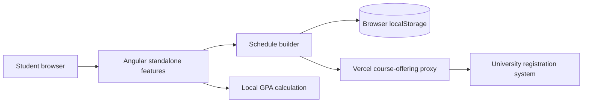

# Al Albayt Utils

Build a weekly course schedule and estimate semester and cumulative GPA in an Arabic interface.

[](https://angular.dev/)

## Demo and screenshots

<!-- TODO: add public live demo URL -->
Hosted demo pending.

Capture these views using demo data:

- a weekly schedule with selected sections and attendance-day totals
  <!-- TODO: add screenshot of a weekly schedule with selected sections and attendance-day totals -->
- the course filter panel showing faculty and department
  <!-- TODO: add screenshot of the course filter panel showing faculty and department -->
- the GPA calculator showing a repeated course and the cumulative result
  <!-- TODO: add screenshot of the GPA calculator showing a repeated course and the cumulative result -->

## Key features

**Schedule planning**

- Search course offerings by name or code and filter by instructor, days, time, credits, faculty and department.
- Browse long result lists using incremental scrolling.
- Add sections to a weekly timetable and review conflicts before replacing a section.
- See total credit hours and attendance days update as you make changes.

**GPA planning**

- Estimate semester and cumulative GPA from grades, credit hours and an existing academic record.
- Model repeated courses using the previous grade and see how they affect the result.
- Use both tools in a right-to-left Arabic interface.

## Architecture



The scheduler uses a service to fetch offerings and keeps the selected sections
in browser storage. GPA calculations use form inputs and computed signals. The
Vercel function provides a same-origin route to the university data for the
deployed frontend.

## Design decisions

### Course-data boundary

- **Problem** · The browser needs current offerings from an external university system.
- **Solution** · In the deployed layout, the Angular service calls a Vercel function that forwards the form request and returns the upstream response.
- **Trade-off** · The schedule search depends on upstream availability and response shape.

### Schedule persistence

- **Problem** · Students should be able to revisit their selections after a reload.
- **Solution** · A signal-backed service persists selected sections in localStorage and checks time conflicts before replacement.
- **Trade-off** · Selections stay in the current browser and may need review when offerings change.

### Repeated-course GPA

- **Problem** · A repeat can change grade points and credit totals differently from a new course.
- **Solution** · Computed values combine new courses, prior credits and prior grades, applying the app’s higher-grade rule for eligible repeats.
- **Trade-off** · The estimate is based on user input and the grade rules encoded in the application.

## Tech stack

| Area | Technology |
| --- | --- |
| Backend | Vercel serverless proxy |
| Frontend | Angular 22, signals, reactive forms, Tailwind CSS 4 |
| Data and caching | University registration feed and browser localStorage |
| Real-time | Reactive updates within the active browser |
| Security | No application login |
| Testing | Angular test builder and Vitest |
| DevOps | Angular CLI and Vercel routing |

## Getting started

Use Node.js 22.22.3+ on 22.x or 24.15.0+ on 24.x and npm.

```bash
git clone https://github.com/FerasAbukweik/aabu_utils.git
cd aabu_utils
npm ci
npm start
```

Open [http://localhost:4200/gpa-calculator](http://localhost:4200/gpa-calculator)
for the GPA calculator or
[http://localhost:4200/make-schedual](http://localhost:4200/make-schedual)
for the schedule shell. No `.env` is required for the Angular app.

The current Angular dev target does not provide `/api/proxy`. Course search
requires the Vercel function and a reachable university service. Use a Vercel
environment that serves this repository's frontend and function together.

```bash
npm run build
```

The Angular build writes to `dist/`. The repository has no Docker setup.

## Running tests

```bash
npm test -- --watch=false
```

The current suite is an app-shell smoke spec. The title-rendering case needs
an Angular router provider. The scheduler and GPA calculation have no dedicated
automated specs in this repository.

## Project structure

```text
api/proxy.js                  # Vercel course-offering function
src/
├── Core/                     # Data types, HTTP service and selection state
├── Features/make-schedual/   # Course search and weekly timetable
├── Features/gpa-calculator/  # GPA form and calculations
├── Layout/                   # Navigation and application shell
└── app/                      # Angular bootstrap and routes
vercel.json                   # Function and SPA routing
```

## API overview

The browser calls the same-origin `/api/proxy` route for course offerings.
GPA calculations run entirely in the browser. The project has no Swagger UI.

## Known limitations and roadmap

- Align Angular development routing with the production proxy path.
- Add focused tests for time conflicts and repeat-grade calculations.
- Course search depends on the university feed.
- Schedule selections are per browser. GPA values are planning estimates.

## Author

Firas Abukweik · [LinkedIn](https://www.linkedin.com/in/firas-abukweik/) ·
[GitHub](https://github.com/FerasAbukweik) · [Email](mailto:firas.abukweik@gmail.com)
